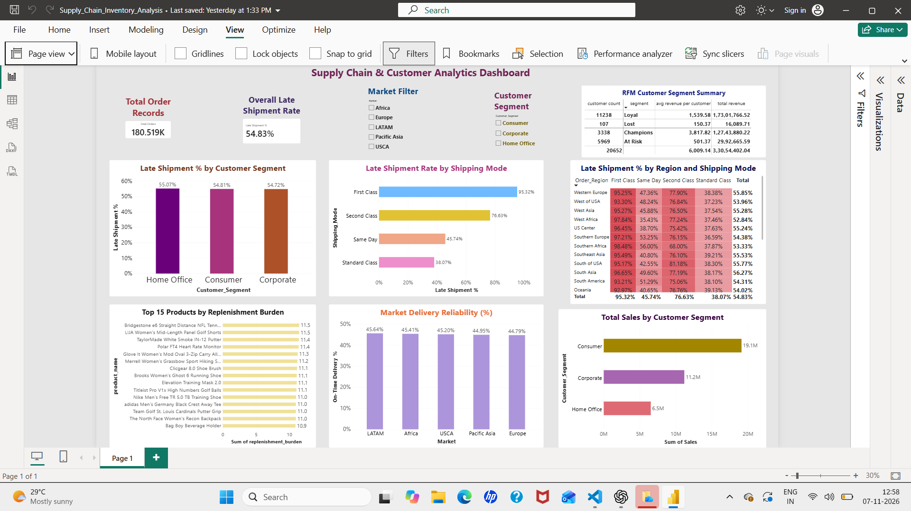

# Supply Chain & Customer Analytics Dashboard

An end-to-end supply chain analytics project analyzing **180,519 order records** to evaluate delivery performance, replenishment risk, market reliability, and customer purchasing behavior.

The project uses Python for data preparation, MySQL for data storage and SQL analysis, and Power BI for interactive dashboard development.

## Project Overview

Supply chain operations involve multiple challenges, including delivery delays, product replenishment requirements, market-level performance differences, and customer retention.

This project analyzes historical order data to answer important business questions:

- Which shipping modes experience the highest delivery delays?
- Which regions have higher late-shipment rates?
- Which products have higher replenishment burdens?
- Which markets demonstrate better delivery reliability?
- Which customer segments contribute the most revenue?

## Dataset

**Source:** [DataCo Smart Supply Chain Dataset – Kaggle](https://www.kaggle.com/datasets/shashwatwork/dataco-smart-supply-chain-for-big-data-analysis)

- Domain: Supply Chain, Logistics and Operations Analytics
- Records: 180,519
- Original columns: 53
- Dataset format: CSV

### Data Preparation

Python and Pandas were used to prepare the dataset before loading it into MySQL.

The preparation process included:

- Reading the CSV dataset.
- Removing unnecessary personal-information fields.
- Cleaning column names for MySQL compatibility.
- Loading records in manageable batches.

Customer names, email addresses, passwords, and address-related fields were excluded from the database import.

### Dataset Limitation

The dataset does not contain an actual on-hand inventory or stock-availability column.

Therefore, this project does not calculate literal reorder alerts. Instead, it uses a **Replenishment Burden Score**, based on average order quantity and average actual shipping lead time, as an approximation of replenishment risk.

## Technology Stack

| Layer | Technology |
|---|---|
| Programming | Python |
| Data Preparation | Pandas |
| Database | MySQL |
| Data Analysis | MySQL, SQL |
| Dashboard | Microsoft Power BI |
| Database Connectivity | MySQL Connector for Python |

## Project Architecture

**CSV Dataset → Python & Pandas → MySQL Database → SQL Analysis → Power BI Dashboard**

1. Dataset: Read the DataCo CSV file.
2. Data preparation: Clean column names and exclude unnecessary personal-information fields using Python and Pandas.
3. Database: Store the prepared records in MySQL.
4. SQL analysis: Calculate delivery, replenishment, market and customer metrics.
5. Visualization: Build interactive Power BI dashboards to communicate business insights.

## SQL Analysis

The project includes eight analytical SQL queries:

| No. | Analysis | Purpose |
|---|---|---|
| 1 | Late Shipment by Shipping Mode | Compare delivery delays across shipping modes |
| 2 | Late Shipment by Region | Identify geographical delivery-delay patterns |
| 3 | Replenishment Risk by Product | Rank products using replenishment burden |
| 4 | Market Reliability | Compare delivery reliability across markets |
| 5 | RFM Analysis | Calculate customer recency, frequency and monetary scores |
| 6 | RFM Segment Summary | Summarize customer count and revenue by segment |
| 7 | Category Options | Retrieve distinct product categories |
| 8 | Filtered Late Shipments | Retrieve late-shipment records for detailed inspection |

**SQL concepts used:**

- CASE WHEN
- GROUP BY and HAVING
- Aggregate functions
- Common Table Expressions (CTEs)
- Window functions and NTILE(4)
- Date parsing and DATEDIFF
- Subqueries and CROSS JOIN
- Conditional calculations

## Power BI Dashboard

The interactive dashboard covers the following analytical areas:

### Delivery Performance
- Total order records
- Overall late-shipment rate
- Late shipment percentage by shipping mode
- Late shipment percentage by customer segment

### Regional and Market Analysis
- Region and shipping-mode delivery performance matrix
- Market delivery reliability

### Product Analysis
- Top 15 products by replenishment burden

### Customer Analysis
- Total sales by customer segment
- RFM customer segment summary
- Market and customer-segment filters

### Dashboard Preview



*Add your actual dashboard screenshot to the screenshots folder using the filename dashboard.png.*

## Key Business Findings

### 1. Shipping Mode Performance

First Class has the highest late-shipment rate at approximately **95.32%**, while Standard Class has the lowest at approximately **38.07%**.

This indicates that a premium shipping label does not necessarily guarantee better delivery performance.

### 2. Regional Delivery Delays

The region-by-shipping-mode analysis shows that First Class experiences high late-shipment rates across several regions.

Standard Class performs better across most regional combinations.

### 3. Product Replenishment Burden

Products were ranked using a replenishment-burden score calculated from average order quantity and average actual shipping lead time.

This provides an approximate way to identify products that may require greater replenishment attention.

### 4. Market Delivery Reliability

Market-level on-time delivery rates are broadly similar, at approximately 45%.

This suggests that delivery delays are not isolated to a single market.

### 5. Customer Segmentation

RFM analysis classifies customers into four groups:

- Champions
- Loyal
- At Risk
- Lost

These segments help identify valuable customers and potential retention opportunities.

## Project Structure

```text
Supply_Chain_Inventory_Analysis/
│
├── data/
│   ├── DataCoSupplyChainDataset.csv
│   └── DescriptionDataCoSupplyChain.csv
│
├── screenshots/
│   └── dashboard.png
│
├── db.py
├── mysql_queries.sql
├── README.md
└── Supply_Chain_Inventory_Analysis.pbix
```

## How to Run

### 1. Clone the repository

```bash
git clone <your-github-repository-url>
```

### 2. Install Python dependencies

```bash
pip install pandas mysql-connector-python
```

### 3. Configure MySQL

Create a MySQL database:

```sql
CREATE DATABASE supply_chain;
```

Configure your MySQL credentials using the `MYSQL_PASSWORD` environment variable, or enter the password when prompted by the Python script.

### 4. Load the dataset

Place the DataCo CSV file inside the `data` folder.

Run:

```bash
python db.py
```

**Note:** The ETL script protects an existing populated `orders` table by default. Do not force a reload unless you intentionally want to replace its contents.

If the database has already been populated, you do not need to run the loading script again.

### 5. Execute SQL queries

Open `mysql_queries.sql` in MySQL Workbench.

Select and execute the required analytical queries against the `supply_chain` database.

### 6. Open the Power BI dashboard

Open:

`Supply_Chain_Inventory_Analysis.pbix`

Connect to the MySQL database if prompted and refresh the data when required.

## Skills Demonstrated

- Python data preparation
- Pandas data cleaning
- MySQL database connectivity
- SQL querying and analytical calculations
- Supply chain and logistics analytics
- Delivery performance analysis
- Replenishment-risk assessment
- RFM customer segmentation
- Power BI dashboard development
- Business insight communication

## Business Value

This project demonstrates how operational order data can be transformed into meaningful business insights.

The analysis can help operations teams identify delivery-performance issues, monitor product replenishment burden, compare market reliability, and prioritize customer-retention activities.

---

**Project Category:** Data Analytics | Supply Chain Analytics | Business Intelligence